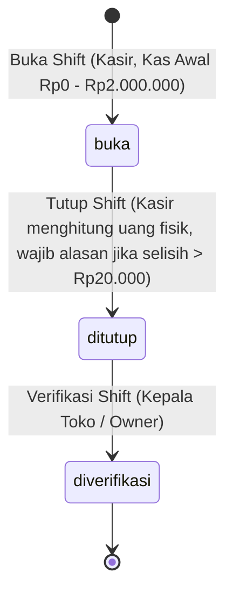
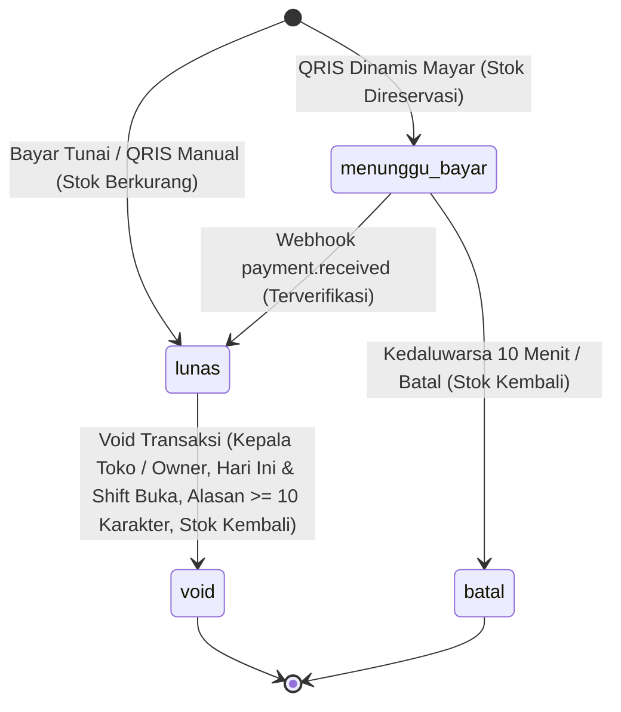

# ☕ Lumbung Kopi dan Roti — Sistem POS Kasir Multi-Cabang

> **Capstone Project · Bootcamp AI Web Programming**
> Solusi Sistem Kasir (*Point of Sale*) Multi-Cabang Berbasis Cloud yang Cepat, Aman Konkurensi, Tervalidasi hingga Level Database, dan Dilengkapi Fitur Pembayaran QRIS Dinamis.

---

## 📌 Ringkasan & Tautan Pengumpulan Proyek

| Informasi                        | Keterangan / Tautan                                                                                                                                                    |
| :------------------------------- | :--------------------------------------------------------------------------------------------------------------------------------------------------------------------- |
| **Klien Fiktif**           | **Lumbung Kopi dan Roti** (Kedai kopi & bakery artisan di 3 cabang)                                                                                              |
| **Cabang Aktif**           | **Tebet** (`TBT`), **Bintaro** (`BTR`), dan **Depok** (`DPK`)                                                                                  |
| **URL Aplikasi (Netlify)** | [https://pos-kasir-zalfa.netlify.app](https://pos-kasir-zalfa.netlify.app) *(Custom Domain: [https://poskasir.zalfaulislam.site](https://poskasir.zalfaulislam.site))* |
| **Repositori GitHub**      | [https://github.com/zalfasayfanah/POS-Kasir](https://github.com/zalfasayfanah/POS-Kasir) *(Publik)*                                                                   |
| **Dokumen Test Plan**      | [docs/test-plan.md](docs/test-plan.md) *(18 Test Cases teruji, Lulus 100%)*                                                                                           |
| **Video Demo (3-5 Menit)** | [Tautan Video Demo di Google Drive / YouTube Unlisted](https://drive.google.com/) *(Silakan sesuaikan tautan)*                                                        |
| **Platform Pengumpulan**   | LMS [innovators.iodacademy.id](https://innovators.iodacademy.id)                                                                                                        |

---

## 🎯 Latar Belakang & Masalah Klien yang Diselesaikan

Sebelum menggunakan sistem ini, **Lumbung Kopi dan Roti** mengandalkan mesin kasir terpisah di tiap cabang dan pencatatan stok manual di buku, yang memicu 5 permasalahan operasional kronis:

1. **Rebutan Stok Terakhir (*Race Condition*):** Roti terakhir sering terjual dua kali saat dua kasir checkout pada detik yang sama.👉 *Solusi:* Implementasi PostgreSQL Stored Procedure dengan row-level lock `FOR UPDATE` yang menjamin pengurangan stok bersifat *atomic* (*all-or-nothing rollback*). Stok tidak akan pernah minus.
2. **Nomor Struk Manual & Ganda:** Nomor struk ditulis tangan dan sering dobel atau terlewat.👉 *Solusi:* Penomoran otomatis berurutan `KODE-YYYYMMDD-NNNN` (contoh: `TBT-20261016-0001`) yang dikunci per cabang per hari secara atomic.
3. **Selisih Kas Laci Kasir Tanpa Tanggung Jawab:** Uang di laci kasir sering tidak cocok dengan transaksi tanpa kejelasan kasir yang bertugas.👉 *Solusi:* Manajemen shift kasir terstruktur (buka shift dengan modal awal $\le$ Rp2.000.000, hitung kas fisik tutup shift, wajib alasan jika selisih kas fisik $> \text{Rp20.000}$, serta verifikasi oleh Kepala Toko/Owner).
4. **Pembatalan (*Void*) Liar:** Kasir membatalkan transaksi sesuka hati tanpa pengawasan.👉 *Solusi:* Hak *void* dibatasi ketat hanya untuk Kepala Toko dan Owner, hanya berlaku untuk transaksi lunas hari ini saat shift masih buka, wajib alasan minimal 10 karakter, otomatis mengembalikan stok fisik, dan tercatat permanen di `audit_log`.
5. **Kebocoran Harga Modal & Laba:** Pemilik tidak dapat memantau laba harian per cabang karena harga modal rahasia takut terbaca oleh kasir.
   👉 *Solusi:* Penguncian data sensitif di level database menggunakan *Row Level Security* (RLS) pada tabel `riwayat_harga_modal` dan kalkulasi margin laba kotor di server-side yang tidak pernah dikirim ke peramban Kasir atau Kepala Toko.

---

## 🛠️ Tech Stack & Arsitektur

Aplikasi dibangun sesuai dengan pedoman teknologi wajib capstone:

- **Frontend & Fullstack Framework:** [Next.js](https://nextjs.org/) (App Router, Server Actions, Route Handlers) dengan [TypeScript](https://www.typescriptlang.org/)
- **Styling & UI Components:** [Tailwind CSS v4](https://tailwindcss.com/), [Lucide React Icons](https://lucide.dev/), dan [Sonner](https://sonner.emilkowal.ski/) (Toast Notifications)
- **Database, Auth & Backend:** [Supabase](https://supabase.com/)
  - **PostgreSQL**: Relasi tabel ACID dengan Foreign Keys & Check Constraints.
  - **Supabase Auth**: Manajemen sesi login terintegrasi dengan tabel `profiles`.
  - **Row Level Security (RLS)**: Proteksi data multitenant cabang dan isolasi harga modal.
  - **Database Functions & Stored Procedures (`PL/pgSQL`)**: Eksekusi atomic transaksi, void, shift, dan penomoran struk dengan lock `FOR UPDATE`.
  - **Immutable Audit Trail**: Trigger & procedure logging yang tidak dapat diubah atau dihapus.
- **Hosting & Deployment:** [Netlify](https://www.netlify.com/) (CI/CD via GitHub, Edge Network, `@netlify/plugin-nextjs`)
- **Third-Party Payment Gateway (Nilai Tambah):** [Mayar API V2 Sandbox](https://mayar.id/) untuk penerbitan tagihan QRIS dinamis dan webhook realtime.

---

## 👥 Matriks Hak Akses Peran (RBAC)

Aplikasi memiliki 3 peran dengan wewenang yang terisolasi di sisi UI, Middleware, dan Database RLS:

| Fitur / Halaman                               |       Kasir (`kasir`)       |     Kepala Toko (`kepala_toko`)     |           Owner (`owner`)           |
| :-------------------------------------------- | :----------------------------: | :-----------------------------------: | :------------------------------------: |
| **Kasir POS (`/kasir`)**              |  ✅ Akses Penuh (Buat Order)  |         ❌ Ditolak / Redirect         |         ❌ Ditolak / Redirect         |
| **Shift Saya (`/shift`)**             | ✅ Buka & Tutup Shift Miliknya |         ❌ Ditolak / Redirect         |         ❌ Ditolak / Redirect         |
| **Daftar Transaksi (`/transaksi`)**   |  👁️ Transaksi miliknya saja  | 👁️ Semua transaksi cabangnya & Void |        👁️ Semua cabang & Void        |
| **Stok Cabang (`/stok`)**             |     ❌ Ditolak / Redirect     |  ✅ Lihat & Sesuaikan Stok Cabangnya  | ✅ Lihat & Sesuaikan Stok Semua Cabang |
| **Shift Cabang (`/shift-cabang`)**    |     ❌ Ditolak / Redirect     |     ✅ Verifikasi Shift Cabangnya     |    ✅ Verifikasi Shift Semua Cabang    |
| **Katalog Produk (`/produk`)**        |     ❌ Ditolak / Redirect     | 👁️ Lihat Produk (Tanpa Harga Modal) | ✅ Kelola Produk, Status & Harga Jual |
| **Riwayat Harga Modal**                 |    ❌ Diblokir RLS Database    |       ❌ Diblokir RLS Database       |     ✅ Kelola Riwayat Harga Modal     |
| **Laporan & Dashboard (`/laporan`)**  |     ❌ Ditolak / Redirect     |  👁️ Penjualan Cabang (Tanpa Laba)  | ✅ Semua Cabang + Laba Kotor & Margin |
| **Pengaturan & Akun (`/pengaturan`)** |     ❌ Ditolak / Redirect     |         ❌ Ditolak / Redirect         |   ✅ Kelola Staf, Mayar & Audit Log   |

> **Catatan Pengalihan Default Setelah Login:**
>
> - Kasir $\rightarrow$ langsung ke halaman Kasir (`/kasir`)
> - Kepala Toko $\rightarrow$ langsung ke halaman Transaksi (`/transaksi`)
> - Owner $\rightarrow$ langsung ke halaman Laporan (`/laporan`)

---

## 🔑 Akun Uji Resmi (Test Accounts)

Seluruh akun uji dapat digunakan langsung di URL produksi Netlify maupun lingkungan lokal.

> **Kata Sandi Latihan untuk Semua Akun:** `Latihan#2026`

| Peran                      | Nama Lengkap        | Email Login                          |  Cabang Terikat  | Keterangan Pengujian                                           |
| :------------------------- | :------------------ | :----------------------------------- | :---------------: | :------------------------------------------------------------- |
| **Owner**            | Ratna Kusumawardani | `ratna.owner@lumbung.test`         | *Semua Cabang* | Akses penuh, kelola produk, laba, staf, dan audit log          |
| **Kepala Toko**      | Bayu Prasetyo       | `bayu.kt.tebet@lumbung.test`       |  Tebet (`TBT`)  | Verifikasi shift & void transaksi cabang Tebet                 |
| **Kepala Toko**      | Sekar Ayuningtyas   | `sekar.kt.bintaro@lumbung.test`    | Bintaro (`BTR`) | Verifikasi shift & penyesuaian stok cabang Bintaro             |
| **Kepala Toko**      | Hendra Saputra      | `hendra.kt.depok@lumbung.test`     |  Depok (`DPK`)  | Monitoring cabang Depok                                        |
| **Kasir**            | Dimas Arya          | `dimas.kasir.tebet@lumbung.test`   |  Tebet (`TBT`)  | Akun kasir aktif Tebet (shift & order POS)                     |
| **Kasir**            | Putri Maharani      | `putri.kasir.tebet@lumbung.test`   |  Tebet (`TBT`)  | Kasir kedua Tebet (uji konkurensi stok ganda)                  |
| **Kasir**            | Fajar Nugroho       | `fajar.kasir.bintaro@lumbung.test` | Bintaro (`BTR`) | Kasir cabang Bintaro                                           |
| **Kasir**            | Wulan Sari          | `wulan.kasir.depok@lumbung.test`   |  Depok (`DPK`)  | Kasir cabang Depok                                             |
| **Kasir (Nonaktif)** | Rizky Ramadhan      | `rizky.kasir.depok@lumbung.test`   |  Depok (`DPK`)  | **Uji Kasus Negatif (BR-01):** Ditolak login oleh sistem |

---

## 📋 Implementasi Aturan Bisnis (BR-01 s/d BR-12)

Seluruh 12 aturan bisnis dijaga hingga level database:

- **BR-01 (Isolasi Cabang & Akun Nonaktif):** Kasir dan Kepala Toko hanya dapat mengakses data cabangnya sendiri melalui Supabase RLS (`cabang_id = get_auth_cabang_id()`). Akun nonaktif ditolak langsung saat login dan oleh middleware.
- **BR-02 (Prasyarat Shift Buka & Batas Kas Awal):** Transaksi hanya dapat dibuat oleh kasir dengan shift berstatus `buka`. Kas awal divalidasi antara Rp0 hingga Rp2.000.000 melalui check constraint dan server action.
- **BR-03 (Stok Anti-Minus & Atomic Rollback):** Produk berstatus `lacak_stok = true` dikunci menggunakan `FOR UPDATE`. Jika ada 1 item di keranjang yang stoknya kurang, seluruh transaksi digagalkan (*all-or-nothing rollback*). Minuman racikan tidak dilacak stoknya.
- **BR-04 (Penomoran Struk Berurutan Unik):** Format struk `KODE-YYYYMMDD-NNNN` (contoh: `TBT-20261016-0001`). Counter harian per cabang dikunci saat checkout untuk mencegah nomor ganda saat checkout bersamaan. Transaksi void tetap mempertahankan nomor struknya.
- **BR-05 (Integritas Harga Jual Produk):** Harga jual diambil langsung dari snapshot tabel `produk` di database. Manipulasi payload dari browser akan ditolak oleh stored procedure. Produk nonaktif tidak dapat dijual. Kuantitas per produk dibatasi 1–99.
- **BR-06 (Batas Diskon Transaksi):** Diskon maksimal 10% dari subtotal dan wajib menyertakan alasan. Total akhir dihitung: `total = subtotal - diskon`.
- **BR-07 (Validasi Pembayaran Tunai & QRIS):** Pembayaran tunai mewajibkan uang diterima $\ge$ total belanja dan kembalian dihitung presisi. Pembayaran QRIS mewajibkan nominal pas.
- **BR-08 (Aturan Pembatalan / Void):** Hanya Kepala Toko cabangnya atau Owner yang dapat melakukan void. Syarat: transaksi berstatus `lunas`, dibuat hari ini, dan shift kasir masih `buka`. Alasan void wajib minimal 10 karakter. Void otomatis mengembalikan stok fisik dan mencatat log audit.
- **BR-09 (Tutup Shift & Toleransi Selisih Kas):** Kasir menginput hitungan uang fisik di laci saat tutup shift. Kas seharusnya dihitung otomatis dari `kas_awal + total_tunai_lunas`. Jika selisih $> \text{Rp20.000}$ (lebih maupun kurang), kolom catatan wajib diisi. Setelah tutup shift, kasir tidak dapat menambah transaksi baru.
- **BR-10 (Alur Status Shift Searah):** Status shift bergerak searah: `buka` $\rightarrow$ `ditutup` $\rightarrow$ `diverifikasi`. Verifikasi hanya dapat dilakukan oleh Kepala Toko atau Owner pada shift yang sudah berstatus `ditutup`.
- **BR-11 (Kerahasiaan Harga Modal & Perhitungan Laba):** Tabel `riwayat_harga_modal` hanya dapat diakses oleh Owner melalui RLS. Kepala Toko dan Kasir menerima array kosong bila mencoba query langsung. Laba kotor dihitung berdasarkan harga modal yang berlaku pada tanggal transaksi dibuat.
- **BR-12 (Penyesuaian Stok & Immutability Audit Log):** Penyesuaian stok (masuk, rusak, opname) hanya boleh dilakukan oleh Kepala Toko atau Owner dengan mencantumkan alasan. Seluruh aksi sensitif (*void*, verifikasi shift, ubah harga, sesuaikan stok, ubah staf) otomatis dicatat di `audit_log` dengan snapshot nilai sebelum dan sesudah. Tabel `audit_log` tidak memiliki policy `UPDATE` atau `DELETE`.

---

## 🔄 Diagram Alur Status

### 1. Alur Status Shift Kasir



### 2. Alur Status Transaksi POS



---

## 🚀 Fitur Nilai Tambah & Kreativitas (Kriteria C5 — Bobot 25%)

Selain seluruh fitur inti PRD, aplikasi dilengkapi peningkatan nilai tambah yang nyata bagi bisnis klien:

1. **Integrasi Payment Gateway Mayar (QRIS Dinamis & Webhook Realtime):**
   - Kasir dapat menerbitkan invoice QRIS dinamis melalui integrasi API Mayar V2 sandbox.
   - Transaksi berstatus `menunggu_bayar` dengan proteksi stok terpesan agar tidak terjual ke pelanggan lain.
   - Webhook `/api/webhooks/mayar` memproses notifikasi pelunasan secara otomatis dan idempoten (mencegah pemrosesan ganda).
   - Menu **Mayar Transactions Viewer** di halaman Pengaturan untuk memantau status pembayaran langsung dari dashboard.
2. **Pemesanan Mandiri Meja Pelanggan (*Customer Self-Service Table Order* di `/order`):**
   - Pelanggan dapat memindai kode QR di meja (misal: `/order?cabang=TBT&meja=05`) untuk melihat katalog menu cabang secara realtime, memilih produk yang masih tersedia stoknya, dan memesan tanpa harus antre di kasir.
3. **Ekspor Data Laporan & Transaksi ke Excel (`.xlsx`) & CSV:**
   - Memudahkan Kepala Toko dan Owner mengekspor ringkasan penjualan, riwayat transaksi, dan rekapitulasi shift untuk arsip pembukuan offline.
4. **Pencetakan Struk Format Thermal 58mm & Ekspor PDF:**
   - Desain cetak struk monospaced yang dioptimalkan untuk printer thermal kasir 58mm standar industri, dilengkapi tombol download/print PDF langsung dari browser.
5. **Dashboard Analitik Finansial & Operasional:**
   - Grafik batang penjualan harian per cabang.
   - Grafik donat komposisi metode pembayaran (Tunai vs QRIS).
   - Grafik 10 produk terlaris berdasarkan kuantitas penjualan.
   - Tabel selisih kas per shift dengan penanda visual khusus selisih $> \text{Rp20.000}$.
   - Grafik garis laba harian dan kartu margin keuntungan (eksklusif dihitung di sisi server untuk Owner).

---

## 💻 Panduan Menjalankan Proyek Secara Lokal

### Prasyarat

- [Node.js](https://nodejs.org/) v18.18+ atau v20+
- Akun dan project [Supabase](https://supabase.com/)
- Akun sandbox [Mayar](https://dashboard-sandbox.mayar.id/) (opsional untuk fitur QRIS)

### Langkah Instalasi

1. **Clone Repositori:**

   ```bash
   git clone https://github.com/zalfasayfanah/POS-Kasir.git
   cd POS-Kasir
   ```
2. **Instal Dependensi:**

   ```bash
   npm install
   ```
3. **Konfigurasi Environment Variables:**
   Salin berkas `.env.example` menjadi `.env.local`:

   ```bash
   cp .env.example .env.local
   ```

   Lengkapi nilai variabel di dalam `.env.local`:

   ```env
   NEXT_PUBLIC_SUPABASE_URL=https://your-project-id.supabase.co
   NEXT_PUBLIC_SUPABASE_ANON_KEY=your-supabase-anon-key
   SUPABASE_SERVICE_ROLE_KEY=your-supabase-service-role-key
   MAYAR_API_KEY=your-mayar-api-key
   MAYAR_BASE_URL=https://api.mayar.io/hl/v2
   ```
4. **Inisialisasi Database & Seeding Data:**
   Jalankan script otomatis untuk migrasi dan mengisi data contoh 3 cabang, 9 akun, produk, serta riwayat transaksi:

   ```bash
   node scripts/seed_database.js
   ```
5. **Jalankan Development Server:**

   ```bash
   npm run dev
   ```

   Buka peramban di [http://localhost:3000](http://localhost:3000).

---

## 🛡️ Catatan Keputusan Desain & Keamanan (ADR)

- **Keamanan Berlapis (*Defense in Depth*):**
  Validasi tidak hanya bertumpu pada tombol UI yang dinonaktifkan atau disembunyikan. Aturan bisnis (seperti stok anti-minus, batas kas awal, batas diskon 10%, dan syarat void) ditegakkan langsung oleh PostgreSQL Stored Procedures, Check Constraints, dan RLS Supabase.
- **Penanganan Konkurensi Tinggi:**
  Operasi checkout dan penerbitan nomor struk menggunakan klausa `SELECT ... FOR UPDATE` pada baris stok cabang dan baris cabang. Hal ini mengeliminasi celah *race condition* jika dua kasir checkout produk stok terbatas pada milidetik yang sama.
- **Kerahasiaan Data Sensitif (HPP & Margin):**
  Sesuai BR-11, tabel `riwayat_harga_modal` diproteksi RLS khusus peran `owner`. Kepala Toko atau Kasir yang mencoba memanggil tabel tersebut melalui console browser hanya akan menerima data kosong `[]`. Di halaman Laporan, kalkulasi laba dieksekusi di Server Action dan komponen tidak dirender sama sekali untuk non-owner.
- **Audit Log Bersifat Permanen (*Append-Only*):**
  Tabel `audit_log` hanya mengizinkan operasi `INSERT` via Stored Procedure. Tidak ada hak akses `UPDATE` maupun `DELETE` untuk peran apa pun guna menjamin keaslian riwayat forensik sistem kasir.
- **Karakteristik Aplikasi Internal:**
  Seluruh halaman dilengkapi meta tag `noindex, nofollow` guna mencegah pengindeksan oleh mesin pencari publik. Akses halaman dibentengi oleh Next.js Middleware route-guard berbasis peran.

---

## ✅ Checklist Kesiapan Rilis (Release Checklist)

- [X] Aplikasi aktif dan dapat diakses publik di URL Netlify ([poskasir.zalfaulislam.site](https://poskasir.zalfaulislam.site/)).
- [X] Seluruh akun login uji coba (Owner, Kepala Toko, Kasir) berhasil masuk dan diarahkan sesuai perannya.
- [X] Berkas `.env.local` terabaikan oleh Git (`.gitignore`) dan tidak ada rahasia (*service role* / API key) di client-side.
- [X] Row Level Security (RLS) aktif di seluruh tabel database Supabase.
- [X] Halaman internal menolak akses langsung melalui URL bila peran tidak sesuai.
- [X] Data contoh terisi lengkap dan dashboard menampilkan visualisasi data nyata.
- [X] Log audit mencatat seluruh aksi sensitif secara otomatis.
- [X] Pengaturan `noindex` terpasang di seluruh antarmuka internal.
- [X] Repositori GitHub bersifat publik dan dapat diakses tanpa perlu login.
- [X] Berkas dokumentasi pengujian lengkap tersimpan di [`docs/test-plan.md`](docs/test-plan.md).

---

## 📂 Struktur Repositori & Dokumentasi

```text
POS-Kasir/
├── docs/
│   ├── Petunjuk_Capstone_Project.md   # Pedoman resmi pengerjaan capstone
│   ├── PRD_POS.md                     # Product Requirement Document (BR-01 s/d BR-12)
│   ├── ERD_POS.md & ERD_POS.png       # Spesifikasi dan diagram relasi database
│   ├── Data_Contoh_POS.xlsx           # Data awal pengujian (akun, produk, transaksi)
│   ├── rencana_pengerjaan.md          # Rencana kerja dan panduan sistem visual
│   └── test-plan.md                   # 18 Test Cases pengujian aturan bisnis & RBAC
├── scripts/
│   ├── seed_database.js               # Script seeding auth & data contoh ke Supabase
│   └── parsed_excel.json              # Hasil ekstrak data spreadsheet contoh
├── src/
│   ├── app/
│   │   ├── (dashboard)/               # Rute kasir, transaksi, stok, shift, laporan, produk, pengaturan
│   │   ├── api/webhooks/              # Webhook receiver Mayar QRIS
│   │   ├── order/                     # Rute Self-Service Table Order pelanggan
│   │   ├── login/                     # Halaman login multi-peran
│   │   └── middleware.ts              # Route guard penegak hak akses per peran
│   ├── components/                    # Komponen UI modular (POS, Shift, Laporan, Pengaturan)
│   ├── lib/                           # Konfigurasi Supabase client & server helper
│   └── types/                         # Definisi TypeScript database dan aplikasi
├── .env.example                       # Contoh template environment variables
├── netlify.toml                       # Konfigurasi build Netlify Next.js
├── package.json
└── README.md                          # Dokumentasi utama proyek
```

---

*Dikembangkan oleh **Zalfaulislam Sayfanah** untuk Capstone Project Bootcamp AI Web Programming (Oktober 2026).*
