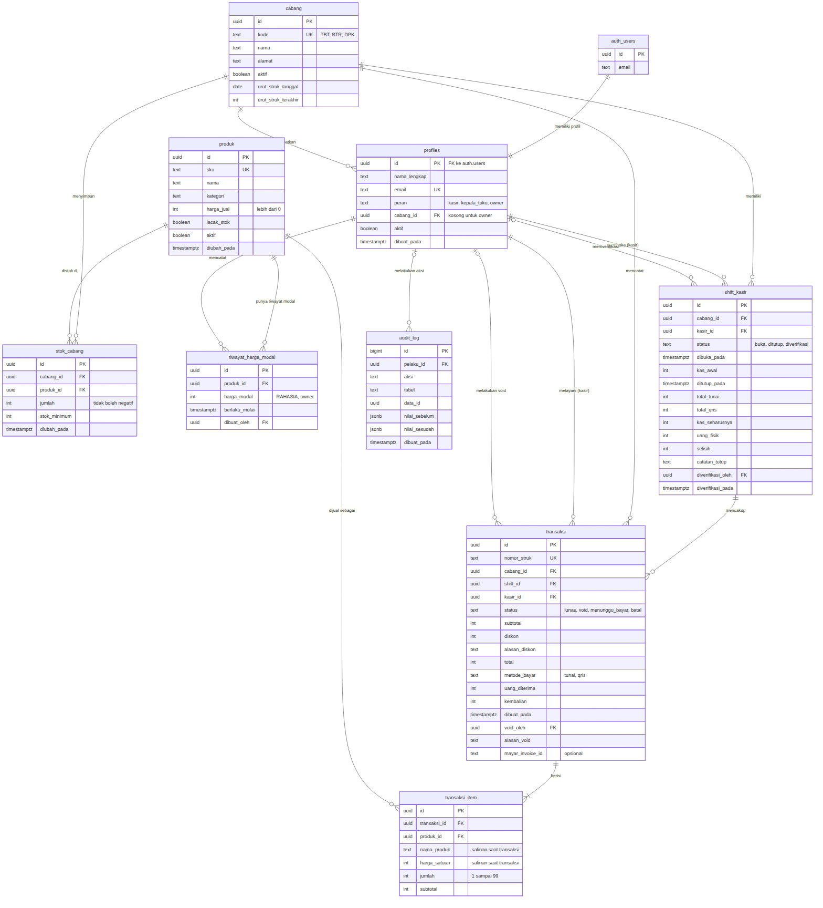

Bootcamp AI Web Programming · Capstone Project

# ERD Aplikasi Kasir (POS) Multi-Cabang

Lumbung Kopi dan Roti · 9 tabel inti

Notasi crow's foot: garis dua tegak berarti tepat satu, lingkaran berarti boleh kosong, kaki tiga berarti banyak. Semua uang dalam rupiah bulat (int). Waktu disimpan sebagai timestamptz; tanggal bisnis memakai WIB. Kotak auth_users mewakili tabel auth.users milik Supabase Auth.

## Penjelasan Tabel dan Kolom

### profiles

Profil setiap akun. Satu baris per akun di auth.users. Dibuat otomatis saat akun didaftarkan, berstatus nonaktif sampai Owner mengatur peran dan cabang.

| Kolom | Tipe | Keterangan | Aturan |
|---|---|---|---|
| id | uuid | PK, sekaligus FK ke auth.users(id) | Wajib, unik |
| nama_lengkap | text | Nama staf | Wajib |
| email | text | Email masuk | Wajib, unik |
| peran | text | kasir, kepala_toko, atau owner | Hanya tiga nilai itu |
| cabang_id | uuid | FK ke cabang. Cabang tempat bertugas | Wajib untuk kasir dan kepala toko, kosong untuk owner; satu kepala toko aktif per cabang |
| aktif | boolean | Akun nonaktif tidak bisa membuka data | Bawaan false |
| dibuat_pada | timestamptz | Waktu dibuat | Bawaan now() |

### cabang

Data cabang toko dan penghitung nomor struk harian.

| Kolom | Tipe | Keterangan | Aturan |
|---|---|---|---|
| id | uuid | PK | Wajib |
| kode | text | Kode tiga huruf untuk nomor struk | Wajib, unik, 3 huruf kapital |
| nama | text | Nama cabang | Wajib |
| alamat | text | Alamat untuk struk | |
| aktif | boolean | Cabang beroperasi atau tidak | Bawaan true |
| urut_struk_tanggal | date | Tanggal (WIB) nomor struk terakhir | |
| urut_struk_terakhir | int | Nomor urut terakhir pada tanggal tersebut | Tidak boleh negatif; kembali ke 1 pada tanggal baru |

### produk

Daftar produk yang dijual di semua cabang dengan harga jual yang sama.

| Kolom | Tipe | Keterangan | Aturan |
|---|---|---|---|
| id | uuid | PK | Wajib |
| sku | text | Kode produk, misalnya KOP-003 | Wajib, unik |
| nama | text | Nama di menu dan struk | Wajib |
| kategori | text | kopi, non_kopi, roti, snack, kemasan | Hanya lima nilai itu |
| harga_jual | int | Harga jual dalam rupiah | Lebih dari 0 |
| lacak_stok | boolean | false untuk minuman racikan | Bawaan true |
| aktif | boolean | Produk nonaktif tidak bisa dijual | Produk tidak dihapus, cukup dinonaktifkan |
| dibuat_pada, diubah_pada | timestamptz | Waktu dibuat dan diubah | |

### riwayat_harga_modal

DATA RAHASIA. Riwayat harga modal per produk, hanya dapat dibaca Owner. Tidak pernah diubah, setiap perubahan menjadi baris baru.

| Kolom | Tipe | Keterangan | Aturan |
|---|---|---|---|
| id | uuid | PK | Wajib |
| produk_id | uuid | FK ke produk | Wajib |
| harga_modal | int | Harga modal per unit dalam rupiah | Tidak boleh negatif |
| berlaku_mulai | timestamptz | Mulai berlaku | Wajib; tidak boleh di masa lalu; unik bersama produk_id |
| dibuat_oleh | uuid | FK ke profiles (Owner) | |
| dibuat_pada | timestamptz | Waktu dicatat | Bawaan now() |

### stok_cabang

Jumlah stok setiap produk yang dilacak di setiap cabang.

| Kolom | Tipe | Keterangan | Aturan |
|---|---|---|---|
| id | uuid | PK | Wajib |
| cabang_id | uuid | FK ke cabang | Wajib |
| produk_id | uuid | FK ke produk | Wajib; pasangan cabang_id dan produk_id unik |
| jumlah | int | Stok saat ini | Tidak boleh negatif |
| stok_minimum | int | Batas penanda stok menipis | Tidak boleh negatif |
| diubah_pada | timestamptz | Perubahan terakhir | |

### shift_kasir

Satu sesi kerja kasir dari buka sampai diverifikasi, termasuk hitungan kas.

| Kolom | Tipe | Keterangan | Aturan |
|---|---|---|---|
| id | uuid | PK | Wajib |
| cabang_id | uuid | FK ke cabang | Wajib |
| kasir_id | uuid | FK ke profiles (kasir) | Wajib; satu kasir hanya boleh punya satu shift buka |
| status | text | buka, ditutup, diverifikasi | Hanya maju, tidak bisa mundur |
| dibuka_pada | timestamptz | Waktu buka | Bawaan now() |
| kas_awal | int | Uang di laci saat buka | Rp0 sampai Rp2.000.000 |
| ditutup_pada | timestamptz | Waktu tutup | Wajib bila status bukan buka |
| total_tunai, total_qris | int | Total transaksi lunas per metode | Dihitung sistem saat tutup |
| kas_seharusnya | int | kas_awal + total_tunai | Dihitung sistem |
| uang_fisik | int | Uang yang dihitung kasir | Tidak boleh negatif |
| selisih | int | uang_fisik dikurangi kas_seharusnya | Bila lebih dari Rp20.000 (plus atau minus), catatan_tutup wajib |
| catatan_tutup | text | Penjelasan kasir | |
| diverifikasi_oleh | uuid | FK ke profiles (kepala toko atau owner) | |
| diverifikasi_pada, catatan_verifikasi | timestamptz, text | Data verifikasi | |

### transaksi

Kepala transaksi penjualan (satu struk).

| Kolom | Tipe | Keterangan | Aturan |
|---|---|---|---|
| id | uuid | PK | Wajib |
| nomor_struk | text | KODE-YYYYMMDD-NNNN | Wajib, unik, urut per cabang per hari |
| cabang_id | uuid | FK ke cabang | Wajib |
| shift_id | uuid | FK ke shift_kasir | Wajib; shift harus berstatus buka saat transaksi dibuat |
| kasir_id | uuid | FK ke profiles | Wajib |
| status | text | lunas, void, menunggu_bayar, batal | Dua status terakhir hanya untuk fitur QRIS Mayar |
| subtotal | int | Jumlah subtotal item | Lebih dari 0 |
| diskon | int | Potongan dalam rupiah | Tidak boleh negatif; paling besar 10% subtotal |
| alasan_diskon | text | Alasan diskon | Wajib bila diskon lebih dari 0 |
| total | int | subtotal dikurangi diskon | Harus sama dengan subtotal - diskon |
| metode_bayar | text | tunai atau qris | Hanya dua nilai itu |
| uang_diterima | int | Uang dari pelanggan | Tunai: minimal total. QRIS: sama dengan total |
| kembalian | int | uang_diterima dikurangi total | Tidak boleh negatif |
| dibuat_pada, dibayar_pada | timestamptz | Waktu transaksi dan pembayaran | |
| void_oleh, void_pada, alasan_void | uuid, timestamptz, text | Data void | Wajib lengkap bila status void; alasan minimal 10 karakter |
| mayar_invoice_id | text | ID tagihan Mayar (opsional) | Unik bila diisi |

### transaksi_item

Baris produk dalam transaksi. Nama dan harga disalin saat transaksi agar riwayat tidak berubah.

| Kolom | Tipe | Keterangan | Aturan |
|---|---|---|---|
| id | uuid | PK | Wajib |
| transaksi_id | uuid | FK ke transaksi | Wajib; ikut terhapus bila transaksi dihapus |
| produk_id | uuid | FK ke produk | Wajib; satu produk sekali per transaksi |
| nama_produk | text | Salinan nama produk | Wajib |
| harga_satuan | int | Salinan harga jual saat transaksi | Lebih dari 0 |
| jumlah | int | Jumlah dibeli | 1 sampai 99 |
| subtotal | int | harga_satuan x jumlah | Harus sama dengan hasil kali |

### audit_log

Catatan aksi sensitif. Hanya dapat dibaca Owner dan tidak dapat diubah atau dihapus.

| Kolom | Tipe | Keterangan | Aturan |
|---|---|---|---|
| id | bigint | PK, nomor otomatis | |
| pelaku_id | uuid | FK ke profiles | |
| aksi | text | void_transaksi, verifikasi_shift, penyesuaian_stok, ubah_harga_jual, ubah_harga_modal, nonaktifkan_produk, ubah_akun | Wajib |
| tabel | text | Nama tabel yang berubah | Wajib |
| data_id | uuid | ID baris yang berubah | |
| nilai_sebelum, nilai_sesudah | jsonb | Nilai sebelum dan sesudah perubahan | |
| dibuat_pada | timestamptz | Waktu aksi | Bawaan now() |
