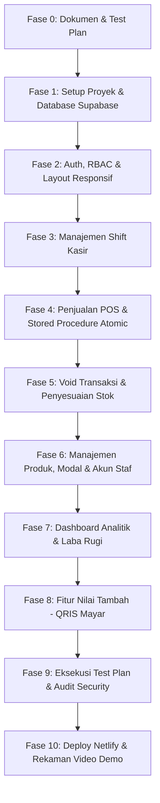

# Rencana Pengerjaan Capstone Project: POS Kasir Multi-Cabang
**Proyek:** Lumbung Kopi dan Roti  
**Target Tenggat:** Selasa, 27 Oktober 2026  
**Stack Utama:** Next.js (App Router, TypeScript), Supabase (PostgreSQL, Auth, RLS, Stored Procedures), Netlify  

---

## 🎯 Ringkasan Tujuan & Sasaran Kualitas
1. **Solusi Masalah Klien (C1 - Bobot 25%)**:
   - Mencegah penjualan dobel pada stok terakhir (operasi atomic & row lock `FOR UPDATE`).
   - Format nomor struk urut unik harian per cabang (`KODE-YYYYMMDD-NNNN`).
   - Disiplin kas laci melalui alur pembukaan, penutupan shift, rekonsiliasi selisih (> Rp20.000 wajib catatan), dan verifikasi kepala toko.
   - Hak akses berjenjang (Kasir, Kepala Toko, Owner) dengan proteksi data sensitif (harga modal & laba kotor hanya untuk Owner).
2. **Kesiapan Industri & Fungsionalitas (C2 & C3 - Bobot 40%)**:
   - Keamanan dijaga hingga layer database (RLS + Stored Procedure), bukan sekadar menyembunyikan elemen UI.
   - Route guard middleware menolak direct URL traversal.
   - Audit trail permanen untuk aksi sensitif (*void*, *stock adjust*, *price change*, *user change*).
3. **Kreativitas & Fitur Nilai Tambah (C5 - Bobot 25%)**:
   - Integrasi QRIS dinamis (sandbox Mayar API V2) dengan status `menunggu_bayar`, penanganan webhook, serta fallback ekspor laporan/struk thermal.

---

## 🎨 Panduan Desain & Sistem Visual (Design Guidelines)

Sesuai identitas klien **"Lumbung Kopi dan Roti"** dan spesifikasi PRD (Bagian 7 & 10):

1. **Target Perangkat & Tata Letak POS (Tablet 10" / $\ge$ 1024px):**
   - **Split-Screen POS:** Sisi kiri untuk katalog menu (tab filter kategori + grid kartu produk touch-friendly), sisi kanan untuk keranjang belanja sticky (penyesuaian qty, diskon, kalkulasi otomatis, dan tombol aksi pembayaran cepat).
   - **Touch Target:** Tombol dan kartu produk berukuran minimal 44x44px untuk kenyamanan sentuhan layar tablet kasir tanpa salah klik.
   - **Format Struk:** Desain struk thermal 58mm monokrom proporsional, font monospaced untuk item dan harga, ramah printer kasir langsung atau simpan PDF.

2. **Palet Warna (Artisanal Coffee & Bakery Theme):**
   - **Primary / Brand Accent:** Warm Amber & Roasted Coffee (`#B45309`, `#D97706`, `#78350F`) menghadirkan identitas visual kedai kopi dan bakery yang otentik.
   - **Neutral Background:** Clean warm slate/stone (`#FAFAF9` / `#F5F5F4`) dengan surface kartu putih bersih (`#FFFFFF`) dan border lembut (`#E7E5E4`).
   - **Status & Feedback Colors:**
     - *Success / Lunas / Buka:* Forest Emerald (`#059669`)
     - *Warning / Selisih Kas / Stok Tipis:* Amber Gold (`#D97706`)
     - *Danger / Void / Ditolak:* Crimson Red (`#DC2626`)
     - *Info / Diverifikasi:* Indigo Slate (`#4F46E5`)

3. **Tipografi & Hirarki Angka:**
   - **Font Utama:** `Inter` atau `Geist Sans` (sans-serif modern dengan keterbacaan tinggi dalam kondisi kasir cepat).
   - **Angka Finansial & Struk:** Font monospaced / tabular figures (`font-mono`) agar digit harga rupiah, kembalian, dan nomor urut struk selalu sejajar rapi.

4. **Feedback Interaktif & Visual Alerts:**
   - **Toast Feedback (Sonner):** Notifikasi instan saat item masuk keranjang, saat checkout berhasil, atau saat validasi aturan bisnis menolak aksi.
   - **Badge & Highlight:**
     - Penanda sisa stok cabang di setiap kartu produk (badge khusus untuk produk yang tidak dilacak stoknya).
     - Highlight oranye/merah untuk produk dengan `stok <= stok_minimum`.
     - Highlight kontras tinggi untuk shift kasir dengan selisih kas fisik $> \text{Rp20.000}$ (lebih maupun kurang).
     - Badge warna status transaksi (`lunas`, `void`) dan status shift (`buka`, `ditutup`, `diverifikasi`).

---

### 📋 Rincian Tiap Fase

#### **Fase 0: Inventarisasi & Dokumen Spesifikasi**
- [x] Merapikan seluruh berkas acuan ke folder [`docs/`](file:///d:/MaSelf/Bootcamp%20Plan%20Indo/POS-Kasir/docs):
  - `Petunjuk_Capstone_Project.md`
  - `PRD_POS.md`
  - `ERD_POS.md` & `ERD_POS.png`
  - `Data_Contoh_POS.xlsx`
- [x] Menyusun dokumen [`docs/test-plan.md`](file:///d:/MaSelf/Bootcamp%20Plan%20Indo/POS-Kasir/docs/test-plan.md) berisi minimal 15 test case (positif, negatif, uji batas, uji hak akses) yang merujuk kode `BR-01` sampai `BR-12`.
- [x] Menyusun matriks hak akses 3 peran (`Kasir`, `Kepala Toko`, `Owner`) untuk setiap halaman dan tabel data.

---

#### **Fase 1: Setup Proyek Next.js & Skema Database Supabase**
- [x] Inisialisasi proyek Next.js (App Router, TypeScript, Tailwind CSS, Lucide React, Sonner / Toaster).
- [x] Setup Supabase Client & SSR helper (`@supabase/ssr`).
- [x] Pembuatan skrip SQL migrasi untuk 9 tabel inti di Supabase:
  1. `cabang`
  2. `profiles` (terikat ke `auth.users`)
  3. `produk`
  4. `riwayat_harga_modal` (data rahasia)
  5. `stok_cabang`
  6. `shift_kasir`
  7. `transaksi`
  8. `transaksi_item`
  9. `audit_log`
- [x] Setup Database Triggers:
  - Otomatis membuat baris di `profiles` saat user baru terdaftar di Supabase Auth.
- [x] Konfigurasi Row Level Security (RLS) di seluruh 9 tabel.
- [x] Seeding data contoh dari `Data_Contoh_POS.xlsx` (cabang, akun staf awal, produk katalog, modal, dan stok awal).

---

#### **Fase 2: Autentikasi, Route Guard (RBAC) & Layout Responsif**
- [x] Halaman Login (`/login`) dengan error handling informatif dan quick selector akun uji.
- [x] Middleware Next.js untuk Route Guard:
  - Pengecekan status login & status aktif akun (`aktif = true`, BR-01).
  - Redirect otomatis berdasarkan peran:
    - `kasir` ➔ `/kasir`
    - `kepala_toko` ➔ `/transaksi`
    - `owner` ➔ `/laporan`
  - Blokir akses URL langsung ke halaman yang bukan wewenangnya (misal Kasir membuka `/laporan` atau `/pengaturan` ➔ redirect/403).
- [x] Layout Utama Aplikasi:
  - Navigasi sidebar/navbar adaptif sesuai peran yang sedang login.
  - Informasi nama staf, peran, cabang tugas, dan status shift aktif.
  - Desain responsif nyaman di tablet 10 inci (≥ 1024px) dan desktop (BR non-fungsional).

---

#### **Fase 3: Manajemen Shift Kasir (US-01, US-04, US-05)**
- [x] Halaman **Shift Saya** (`/shift`):
  - Validasi pembukaan shift baru: Kas awal Rp0 s/d Rp2.000.000 (BR-02).
  - Pencegahan multi-shift: 1 kasir maksimal memiliki 1 shift aktif berstatus `buka` (BR-02).
  - Ringkasan shift berjalan: akumulasi total pembayaran tunai & total QRIS secara real-time.
- [x] Formulir **Tutup Shift**:
  - Input hitungan fisik uang laci (`uang_fisik`).
  - Kalkulasi otomatis `kas_seharusnya = kas_awal + total_tunai_lunas`.
  - Validasi catatan: Jika `|selisih| > Rp20.000`, kolom `catatan_tutup` wajib diisi (BR-09).
  - Freeze shift: status berubah menjadi `ditutup`, kasir tidak dapat menambah transaksi baru.
- [x] Halaman **Shift Cabang** (`/shift-cabang` untuk Kepala Toko & Owner):
  - Daftar shift kasir per cabang beserta badge status dan selisih kas.
  - Tombol aksi **Verifikasi Shift**: mengubah status `ditutup` ➔ `diverifikasi` (BR-10).
  - Pencatatan verifikasi ke `audit_log` (BR-12).

---

#### **Fase 4: Antarmuka POS Kasir & Transaksi Aman Konkurensi (US-02, US-03)**
- [x] Halaman **Kasir POS** (`/kasir`):
  - Grid kartu produk dengan filter kategori & kotak pencarian instan.
  - Badge stok per cabang real-time (produk `lacak_stok = false` ditandai khusus).
  - Panel Keranjang Belanja: penyesuaian quantity (1-99), validasi stok di sisi client.
  - Panel Kalkulasi: subtotal, input diskon (maksimal 10% subtotal + wajib isi alasan - BR-06), total akhir.
  - Pilihan metode bayar:
    - **Tunai**: input uang diterima, validasi nominal $\ge$ total, hitung kembalian otomatis (BR-07).
    - **QRIS Manual**: nominal pas sama persis dengan total (BR-07).
- [x] Database Function / Stored Procedure `create_transaksi_atomic`:
  - Validasi bahwa kasir memiliki shift berstatus `buka` (BR-02).
  - Kunci baris cabang dengan `FOR UPDATE` untuk mengenerate nomor struk harian unik `KODE-YYYYMMDD-NNNN` berurutan tanpa celah race condition (BR-04).
  - Kunci baris stok produk yang dilacak dengan `FOR UPDATE`, validasi stok mencukupi (BR-03: anti minus, all-or-nothing rollback bila satu item kurang).
  - Pengurangan stok dan insert `transaksi` + `transaksi_item` dalam 1 transaksi database atomic.
  - Update akumulasi `total_tunai` / `total_qris` pada record shift kasir.
- [x] Modal Struk & Fitur Cetak:
  - Tampilan struk siap cetak format printer thermal 58mm / simpan PDF.

---

#### **Fase 5: Pembatalan Transaksi (Void) & Penyesuaian Stok (US-06, US-07)**
- [ ] Halaman **Transaksi** (`/transaksi`):
  - Filter rentang tanggal, status (`lunas`, `void`), metode bayar, dan cabang.
  - Hak akses data: Kasir hanya melihat transaksi miliknya, Kepala Toko melihat cabangnya, Owner melihat semua cabang (BR-01).
- [ ] Fitur **Void Transaksi**:
  - Modal Void dengan syarat ketat: hanya Kepala Toko cabang terkait atau Owner, hanya transaksi `lunas` di hari yang sama, dan shift kasir masih `buka` (BR-08).
  - Validasi alasan void minimal 10 karakter (BR-08).
  - Database Function `void_transaksi_atomic`:
    - Mengembalikan jumlah stok produk yang dilacak ke `stok_cabang`.
    - Mengubah status transaksi menjadi `void`.
    - Mencatat aksi ke `audit_log` dengan nilai sebelum dan sesudah (BR-12).
- [ ] Halaman **Stok Cabang** (`/stok`):
  - Tabel stok produk per cabang dengan penanda visual stok di bawah minimum (`jumlah <= stok_minimum`).
  - Formulir Penyesuaian Stok (Barang Masuk, Barang Rusak, Stock Opname) disertai alasan wajib.
  - Pencatatan penyesuaian stok ke `audit_log`.

---

#### **Fase 6: Manajemen Produk, Riwayat Modal & Pengaturan Akun (US-08, US-10)**
- [ ] Halaman **Produk** (`/produk`):
  - Owner: Akses penuh (Tambah, Ubah detail, Atur harga jual, Nonaktifkan produk).
  - Kepala Toko: Read-only katalog produk tanpa harga modal.
- [ ] Manajemen **Riwayat Harga Modal** (`riwayat_harga_modal`):
  - Khusus Owner: Tambah harga modal baru dengan tanggal berlaku (`berlaku_mulai` tidak boleh di masa lalu - BR-11).
  - Isolasi RLS: Kolom & tabel harga modal tidak pernah terekspos ke role Kasir/Kepala Toko.
- [ ] Halaman **Pengaturan & Akun** (`/pengaturan`):
  - Kelola staf cabang (buat akun, atur cabang, aktifkan/nonaktifkan staf).
  - Tampilan viewer **Audit Log**: riwayat seluruh aksi sensitif yang tercatat permanen (*immutable*).

---

#### **Fase 7: Dashboard Analitik & Laporan Laba Rugi (US-09)**
- [ ] Halaman **Laporan** (`/laporan`):
  - Filter rentang tanggal (WIB) dan filter cabang.
  - Kartu Metrik Ringkasan: Omzet total, Jumlah Transaksi, Nilai Rata-rata Transaksi, Total Void.
  - Grafik Batang Penjualan Harian per Cabang.
  - Grafik Batang 10 Produk Terlaris (Quantity terjual).
  - Grafik Donat Komposisi Metode Pembayaran (Tunai vs QRIS).
  - Tabel Rekap Selisih Kas per Shift (dengan badge highlight selisih > Rp20.000).
  - **Seksi Khusus Owner**:
    - Kartu Laba Kotor & Margin Laba (Omzet dikurangi HPP sesuai harga modal yang berlaku saat transaksi - BR-11).
    - Grafik Garis Tren Laba Harian per Cabang.
    - Proteksi Server Component: Data laba kotor tidak pernah dikirimkan ke browser Kepala Toko.

---

#### **Fase 8: Fitur Nilai Tambah (Nilai Plus Bobot 25%)**
- [ ] Integrasi Pembayaran **QRIS Dinamis Mayar Sandbox** (PRD Bagian 11):
  - Request pembuatan invoice via Mayar API V2 (`POST /invoices/create`).
  - Status transaksi `menunggu_bayar`, stok diamankan sementara.
  - Endpoint Webhook Netlify (`/api/webhooks/mayar`): verifikasi signature, ubah transaksi ke `lunas`.
  - Mekanisme pembatalan otomatis jika tidak dibayar dalam 10 menit (kembalikan stok).
- [ ] Fitur Ekspor Laporan:
  - Unduh rekap penjualan & shift ke format CSV / PDF.

---

#### **Fase 9: Pengujian Lengkap (Test Plan Execution)**
- [ ] Menjalankan dan mendokumentasikan hasil pengujian minimal 15 test cases pada `docs/test-plan.md`.
- [ ] Uji Kasus Batas (Edge Cases):
  - Pembelian stok tersisa 1 dan stok 0.
  - Dua kasir checkout produk stok 1 secara bersamaan (uji konkurensi).
  - Diskon tepat 10% vs diskon 10.1% (harus ditolak).
  - Pembayaran tunai kurang Rp1 (harus ditolak).
  - Tutup shift selisih Rp20.001 tanpa catatan (harus ditolak).
  - Uji URL bypass Kasir/Kepala Toko ke data rahasia harga modal.

---

#### **Fase 10: Deployment Netlify, Pemeriksaan Kesiapan & Video Demo**
- [ ] Deploy proyek ke Netlify terhubung dengan repository GitHub publik.
- [ ] Konfigurasi Environment Variables di Netlify:
  - `NEXT_PUBLIC_SUPABASE_URL`
  - `NEXT_PUBLIC_SUPABASE_ANON_KEY`
  - `SUPABASE_SERVICE_ROLE_KEY` (hanya di server)
  - `MAYAR_API_KEY` (jika menggunakan fitur Mayar)
- [ ] Pengaturan Supabase Auth: Daftarkan URL Netlify ke Site URL dan Redirect URLs.
- [ ] Pasang `<meta name="robots" content="noindex, nofollow" />` di root layout.
- [ ] Audit Keamanan & Kesiapan Rilis:
  - Pastikan `.env.local` tidak terlacak di Git (`.gitignore`).
  - Uji login semua akun uji dari browser Incognito pada URL Netlify publik.
- [ ] Perekaman Video Demo (durasi 3-5 menit):
  - Pembuka identitas diri & aplikasi (15 detik).
  - Alur utama dengan 3 akun berbeda (2-3 menit).
  - Uji keamanan URL & role-guard (30 detik).
  - Uji penolakan aturan bisnis / boundary (30 detik).
  - Demonstrasi fitur nilai tambah (30-60 detik).
- [ ] Finalisasi dokumen pengumpulan LMS (URL Netlify, Repo GitHub, Akun Uji, Link Video Demo).
